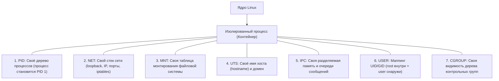

# 01. Что такое контейнер под капотом: Linux Namespaces и Cgroups своими руками

> **Главный закон контейнеризации:**  
> В ядре Linux **нет сущности «контейнер»**.  
> Контейнер — это самый обычный процесс Linux, изолированный с помощью двух фундаментальных механизмов ядра: **Namespaces** (что процесс *видит*) и **Cgroups** (сколько процесс *потребляет*).

---

## 1. Контейнер vs Виртуальная машина (В чем разница?)

| Параметр | Виртуальная машина (KVM, VMware) | Контейнер (Docker, Containerd, Podman) |
| :--- | :--- | :--- |
| **Уровень изоляции** | Аппаратная виртуализация (Гипервизор) | Изоляция на уровне ядра хоста (Syscalls) |
| **Ядро ОС** | У каждой ВМ **своё собственное ядро** | **Одно общее ядро хоста** для всех контейнеров |
| **Старт процесса** | Минуты (загрузка ядра, init, демонов) | Миллисекунды (просто старт процесса через `fork`) |
| **Оверхед по ресурсам** | Высокий (RAM под ядро каждой ВМ) | Практически нулевой (память только под само приложение) |

---

## 2. Семь пространств имён Linux (Namespaces)

Namespaces отвечают за изоляцию ресурсов ядра. Каждый процесс привязан к набору namespaces в каталоге `/proc/<PID>/ns/`.



### Детальный разбор namespaces:
1. **`PID (CLONE_NEWPID)`**:
   Внутри namespace процесс считает себя главным процессом системы с **PID 1**. Процессы хоста для него невидимы. При убийстве PID 1 внутри namespace ядро завершает все дочерние процессы контейнера.
2. **`NET (CLONE_NEWNET)`**:
   Полная изоляция сети. Процесс получает свой независимый интерфейс `lo`, свои сетевые адаптеры (обычно `veth`), собственную таблицу маршрутов `ip route` и правила `iptables`. Порт 80 внутри контейнера не конфликтует с портом 80 на хосте.
3. **`MNT (CLONE_NEWNS)`**:
   Изоляция точек монтирования. Изменения (`mount`, `umount`), сделанные внутри namespace, не видны на хосте. Позволяет подменить корневую файловую систему (`chroot` / `pivot_root`).
4. **`UTS (CLONE_NEWUTS)`**:
   Позволяет процессу задать собственное имя хоста (`hostname`) независимо от сервера.
5. **`IPC (CLONE_NEWIPC)`**:
   Изолирует межпроцессное взаимодействие (очереди сообщений POSIX/SysV, семафоры и Shared Memory). Процесс в контейнере не может подключиться к разделяемой памяти хоста.
6. **`USER (CLONE_NEWUSER)`**:
   Критично для безопасности: пользователь с UID 0 (root) внутри контейнера проецируется на обычного непривилегированного пользователя (например, UID 1000) на хосте. Если злоумышленник вырвется из контейнера, на хосте у него не будет прав root.
7. **`CGROUP (CLONE_NEWCGROUP)`**:
   Скрывает от контейнера глобальную иерархию cgroups хоста, показывая только его собственную подгруппу.

---

## 3. Ограничение ресурсов (Cgroups v2)

Если Namespaces говорят, *что процесс может видеть*, то **Cgroups (Control Groups)** определяют, *сколько ресурсов ему разрешено использовать*.

В Linux cgroups представлены в виде виртуальной файловой системы в `/sys/fs/cgroup/`:
* **`memory.max`**: Жесткий лимит оперативной памяти. Превышение $\rightarrow$ мгновенный расстрел процессом **OOM-Killer**.
* **`memory.high`**: Мягкий лимит. Превышение $\rightarrow$ троттлинг процесса и сброс его кэша страниц без убийства.
* **`cpu.max`**: Квота процессорного времени (CFS scheduler). Например, `50000 100000` означает 50% от одного ядра.
* **`pids.max`**: Максимальное число процессов/потоков (защита от Fork-бомб, когда вредоносный скрипт бесконечно плодит процессы).

---

## 4. Шпаргалка команд: Как инспектировать Namespaces

```bash
# 1. Посмотреть все активные пространства имен в системе:
lsns

# 2. Посмотреть пространства имен конкретного процесса (PID):
ls -l /proc/<PID>/ns/

# 3. Как устроен 'docker exec' под капотом (утилита nsenter):
# Подключиться к сетевому и PID-пространству существующего контейнера:
sudo nsenter -t <PID_контейнера> -n -p bash

# 4. Создать изолированное окружение вручную без Docker (утилита unshare):
# Запуск нового bash с собственным PID, UTS и Mount пространствами:
unshare --pid --uts --mount --fork --mount-proc bash
```

---

## 5. Анатомия запуска контейнера (Что делает Docker за кулисами)

Когда ты выполняешь команду:
```bash
docker run -d --name my-app --memory=512m -p 8080:80 my-image
```
Docker-демон (containerd / runc) выполняет строго следующую последовательность вызовов ядра Linux:

1. **Распаковывает слои образа** (Root Filesystem) в каталог на диске через OverlayFS.
2. **Создаёт контрольную группу** в `/sys/fs/cgroup/docker/<ID>/` и записывает туда лимит памяти `512M` в файл `memory.max`.
3. **Создаёт виртуальную сетевую пару (veth-пару)**: один конец вставляет в docker0-bridge на хосте, второй перемещает в сетевой namespace контейнера.
4. **Вызывает системный вызов `clone()` с флагами изоляции**:
   `CLONE_NEWPID | CLONE_NEWNET | CLONE_NEWNS | CLONE_NEWUTS | CLONE_NEWIPC`.
5. **Вызывает `pivot_root`**, делая распакованную папку новым корнем `/` контейнера.
6. **Запускает целевой процесс** (PID 1 внутри нового пространства).
