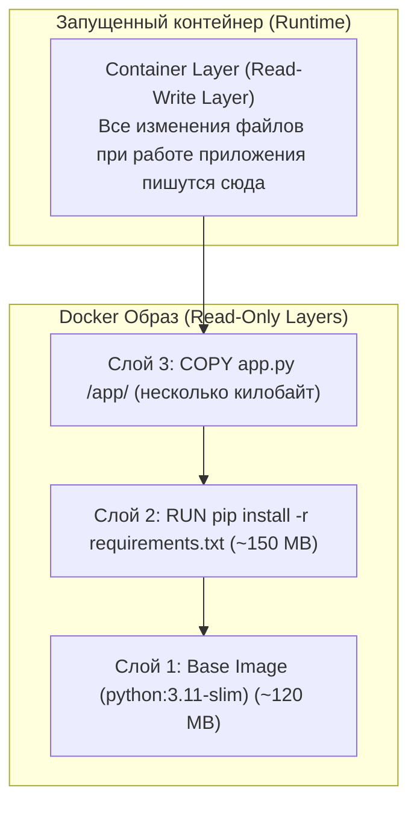

# 02. Оптимизация Dockerfile: Слои, Кэширование и Multi-Stage сборка

> **Главная цель DevOps при сборке образов:**  
> Минимальный размер образа (меньше вес $\rightarrow$ быстрее деплой $\rightarrow$ меньше поверхность атак), максимальная скорость сборки в CI/CD (эффективное кэширование) и безопасность.

---

## 1. Как устроен Docker-образ: Слоистая файловая система (OverlayFS)

Docker-образ состоит из набора неизменяемых слоев, доступных только для чтения (**Read-Only Layers**).  
Каждая инструкция в `Dockerfile` порождает новый слой:



* **Инструкции, создающие слои с файлами:** `RUN`, `COPY`, `ADD`.
* **Инструкции метаданных (не увеличивают вес файлов):** `CMD`, `ENTRYPOINT`, `ENV`, `EXPOSE`, `WORKDIR`, `LABEL`.

---

## 2. Кэширование слоёв и золотое правило порядка инструкций

### Принцип инвалидации кэша:
При сборке (`docker build`) Docker проверяет каждый шаг:
1. Если инструкция и её входные файлы не менялись — Docker берёт готовый слой из кэша (`Using cache`).
2. **Как только на каком-то шаге кэш инвалидировался (например, изменился скопированный файл), ВСЕ ПОСЛЕДУЮЩИЕ ШАГИ ПЕРЕСОБИРАЮТСЯ С НУЛЯ!**

### ❌ Антипаттерн (Как делают новички):
```dockerfile
FROM python:3.11-slim
WORKDIR /app
# ОШИБКА: копируем весь репозиторий сразу
COPY . .
# При ЛЮБОМ изменении одной строчки в коде или README.md
# кэш инвалидируется, и Docker качает все зависимости 5 минут!
RUN pip install -r requirements.txt
CMD ["python", "app.py"]
```

### ✅ Best Practice (Разделение зависимостей и кода):
```dockerfile
FROM python:3.11-slim
WORKDIR /app

# Шаг 1: Копируем ТОЛЬКО файл зависимостей
COPY requirements.txt .

# Шаг 2: Ставим зависимости (слой закэшируется намертво, пока не изменим requirements.txt)
RUN pip install --no-cache-dir -r requirements.txt

# Шаг 3: Копируем меняющийся исходный код в самом конце!
COPY . .

CMD ["python", "app.py"]
```
*Результат:* пересборка проекта при правке кода занимает **0.5 секунды** вместо 5 минут!

---

## 3. Очистка кэша пакетов в одном слое `RUN`

Каждый `RUN` сохраняет своё состояние в неизменяемый слой. Если установить пакеты в одном `RUN`, а удалить кэш в следующем — размер образа **не уменьшится**, потому что файлы останутся в нижнем слое!

```dockerfile
# ❌ ПЛОХО (кэш apt займет 40MB в слое 1 навсегда):
RUN apt-get update && apt-get install -y curl
RUN rm -rf /var/lib/apt/lists/*

# ✅ ПРАВИЛЬНО (установка и очистка в одном слое):
RUN apt-get update && apt-get install -y --no-install-recommends \
    curl \
    ca-certificates \
 && rm -rf /var/lib/apt/lists/*
```

---

## 4. Multi-Stage сборка (Многоэтапный билд)

В скомпилированных языках (Go, Rust, C++) или фронтенде (Node.js / React) для сборки нужны компиляторы, SDK, dev-зависимости (размер 1–2 ГБ). Но в продакшене нужен **только один бинарник** или статические файлы!

**Multi-stage** позволяет использовать несколько директив `FROM`:
* Первый этап (`builder`) собирает проект.
* Финальный этап берет минимальный образ и копирует из этапа сборки **только готовый артефакт**!

### Пример (Go / Rust / Статика):
```dockerfile
# ==========================================
# ЭТАП 1: Сборка бинарника (Тяжелый SDK ~800MB)
# ==========================================
FROM golang:1.22-alpine AS builder
WORKDIR /build

COPY go.mod go.sum ./
RUN go mod download

COPY . .
# Собираем статически слинкованный бинарник без C-зависимостей:
RUN CGO_ENABLED=0 GOOS=linux go build -ldflags="-w -s" -o server .

# ==========================================
# ЭТАП 2: Финальный продакшен-образ (~10MB)
# ==========================================
FROM alpine:3.19
WORKDIR /app

# Копируем ИЗ первого этапа только готовый бинарник:
COPY --from=builder /build/server /app/server

EXPOSE 8080
ENTRYPOINT ["/app/server"]
```
*Результат:* образ «похудел» с **850 MB** до **12 MB**!

---

## 5. Файл `.dockerignore`

Без `.dockerignore` команда `COPY . .` отправляет в контекст сборки весь мусор:
* `.git/` (может весить сотни мегабайт и содержать историю с секретами!).
* `node_modules/` или `venv/` (локальные бинарники другой архитектуры).
* `.env` (секреты разработчика!).
* Логи и временные файлы.

**Пример `.dockerignore`:**
```text
.git
.gitignore
.env
*.log
__pycache__
venv/
node_modules/
.dockerignore
```

---

## 6. Выбор базового образа

| Образ | Размер | Плюсы | Минусы / Риски |
| :--- | :--- | :--- | :--- |
| **`ubuntu` / `debian`** | ~80–120 MB | Есть всё: bash, glibc, пакетные менеджеры | Большой вес, сотни потенциальных CVE уязвимостей |
| **`python:slim` / `node:slim`** | ~40–70 MB | Оптимальный компромисс для скриптовых языков | Нужно вручную ставить системные библиотеки компиляции |
| **`alpine`** | **~5 MB** | Экстремально легкий, минимум уязвимостей | Использует `musl libc` вместо `glibc` (могут быть баги с C-extensions в Python/Go) |
| **`distroless` (Google)** | ~15–30 MB | Максимальная безопасность: **нет даже bash/sh и package manager** | Нельзя сделать `docker exec -it ... bash` для дебага |
