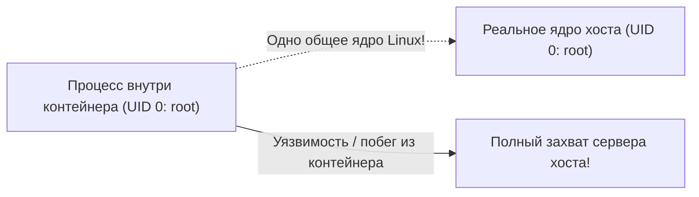

# 03. Безопасность контейнеров: Non-Root, Read-Only RootFS и Сканирование Trivy

> **Золотой стандарт безопасности контейнеров:**  
> Никогда не запускай контейнеры от `root` (UID 0), запрещай запись в корневую файловую систему (`read-only rootfs`), сбрасывай лишние Linux Capabilities и проверяй образы сканером уязвимостей в CI/CD пайплайне.

---

## 1. Главная угроза: Почему `root` в контейнере опасен?

По умолчанию в 90% базовых образов (`ubuntu`, `alpine`, `node`, `python`) процесс запускается от пользователя **`root` (UID 0)**.



* **В чём опасность:**  
  Контейнеры делят **одно общее ядро** с операционной системой хоста.  
  Если злоумышленник найдёт уязвимость в приложении или рантайме (runc, containerd) и сможет совершить побег из контейнера (*Container Escape*), на хосте он **уже будет обладать правами `root`**!
* **Правило безопасности:**  
  Внутри контейнера приложение должно работать от выделенного непривилегированного пользователя (например, UID 10001).

---

## 2. Переход на Non-Root в `Dockerfile`

### Для Alpine Linux:
```dockerfile
FROM alpine:3.19

WORKDIR /app

# Создаем системную группу и пользователя без домашнего каталога и пароля:
RUN addgroup -S appgroup && adduser -S appuser -G appgroup

COPY --chown=appuser:appgroup server /app/server

# КРИТИЧНО: Переключаемся на непривилегированного пользователя:
USER appuser

EXPOSE 8080
ENTRYPOINT ["/app/server"]
```

### Для Debian / Ubuntu:
```dockerfile
FROM python:3.11-slim

WORKDIR /app

# Создаем пользователя с фиксированным UID > 10000:
RUN useradd --create-home --shell /bin/bash --uid 10001 appuser

COPY --chown=appuser:appuser . .

USER 10001

CMD ["python", "app.py"]
```

---

## 3. Неизменяемая файловая система (`Read-Only RootFS`)

Злоумышленник, получивший доступ к приложению через RCE-уязвимость (Remote Code Execution), первым делом пытается:
1. Скачать вредоносный бинарник/майнер (через `curl` или `wget`).
2. Переписать системные библиотеки или конфигурационные файлы (`/etc/passwd`, `/etc/resolv.conf`).
3. Встроить бэкдор в код приложения.

Флаг **`--read-only`** блокирует запись в любые файлы контейнера на уровне ядра Linux!

```bash
# Запуск контейнера в режиме Read-Only:
docker run -d --name secure-app --read-only my-app:latest
```

### А что если приложению нужно писать временные файлы или логи?
Решение — монтировать легковесную временную память в оперативке (**`tmpfs`**) в нужные каталоги:
```bash
docker run -d \
  --name secure-app \
  --read-only \
  --tmpfs /tmp:rw,noexec,nosuid,size=64m \
  --tmpfs /app/logs:rw,size=32m \
  my-app:latest
```
*(Флаги `noexec,nosuid` запрещают запуск любых исполняемых файлов из папки `/tmp` — даже если хакер скачает туда вирус, ядро откажется его выполнять!)*

---

## 4. Сброс привилегий ядра (Linux Capabilities)

В ядре Linux суперпользовательские права разбиты на отдельные атомарные флаги — **Capabilities** (`CAP_SYS_ADMIN`, `CAP_NET_RAW`, `CAP_CHOWN` и т.д.).  
По умолчанию Docker оставляет контейнеру около 14 capabilities, большинство из которых веб-сервису не нужны!

### Best Practice (Сбросить всё и оставить только необходимое):
```bash
docker run -d \
  --name minimal-cap \
  --cap-drop=ALL \
  --cap-add=NET_BIND_SERVICE \
  --security-opt=no-new-privileges:true \
  my-app:latest
```
* **`--cap-drop=ALL`**: Забирает у процесса все системные возможности ядра.
* **`--cap-add=NET_BIND_SERVICE`**: Разрешает слушать порты ниже 1024 (если нужно, например 80 порт).
* **`--security-opt=no-new-privileges:true`**: Запрещает процессам контейнера повышать свои привилегии через биты SUID (например, команду `sudo` или уязвимости ядра).

---

## 5. Сканирование уязвимостей в образах: Сканер Trivy

**Trivy** (от компании Aqua Security) — золотой стандарт DevSecOps для сканирования Docker-образов на известные уязвимости (CVE).

```bash
# Быстрое сканирование образа:
trivy image python:3.11

# Фильтрация только критических и опасных уязвимостей:
trivy image --severity HIGH,CRITICAL my-app:latest

# Использование в CI/CD пайплайне (завершить сборку с кодом 1 при наличии CRITICAL):
trivy image --exit-code 1 --severity CRITICAL my-app:latest
```

---

## 6. Чеклист безопасности контейнера (DevSecOps Baseline)

- [ ] В `Dockerfile` объявлена директива `USER <non-root>` (UID $\ne$ 0).
- [ ] Контейнер запускается с флагом `--read-only` (файловая система только для чтения).
- [ ] Для временных файлов примонтирован изолированный `--tmpfs /tmp:noexec`.
- [ ] Сброшены лишние привилегии ядра через `--cap-drop=ALL`.
- [ ] Включена защита от повышения привилегий `--security-opt=no-new-privileges:true`.
- [ ] Базовый образ проверен сканером Trivy (0 критических уязвимостей).
