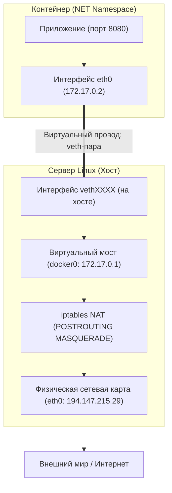

# 04. Сети Docker: Bridge, Host, Overlay и встроенный DNS (127.0.0.11)

> **Фундамент контейнерных сетей:**  
> Сети Docker построены на технологиях ядра Linux: виртуальных интерфейсах (`veth-пары`), программных сетевых мостах (`Linux Bridge`), трансляции адресов (`iptables NAT`) и изоляции `NET Namespaces`.

---

## 1. Сравнительная таблица сетевых драйверов Docker

| Режим сети | Флаг запуска | Изоляция сети | Доступ к localhost хоста | Резолв DNS по имени | Применение |
| :--- | :--- | :--- | :--- | :--- | :--- |
| **`bridge` (Default)** | `--network bridge` (по умолчанию) | Да (`172.17.0.0/16`) | Нет (изолирован) | ❌ **НЕТ** (только по IP) | Устаревший дефолт |
| **`bridge` (User-defined)** | `--network <my-net>` | Да (своя подсеть) | Нет (изолирован) | ✅ **ДА** (через `127.0.0.11`) | **Стандарт для микросервисов** |
| **`host`** | `--network host` | ❌ Нет (стек хоста) | Да (порты на хосте) | Системный DNS хоста | Высоконагруженные сервисы, мониторинг |
| **`none`** | `--network none` | 100% (только `lo`) | Нет доступа к сети | Нет | Безопасные вычисления, пакетная обработка |
| **`container:<ID>`** | `--network container:<name>` | Общий стек с другим контейнером | Общий `localhost` | Общий с целевым контейнером | **Концепция Pod в Kubernetes** |
| **`overlay`** | `--network <overlay-net>` | Межхостовая сеть | Нет | Встроенный DNS Swarm/K8s | Кластерные распределенные сети |

---

## 2. Архитектура сети Bridge под капотом

Как трафик попадает из контейнера во внешний мир и обратно:



### Анатомия veth-пары:
`veth` (Virtual Ethernet) — это виртуальный патч-корд в ядре Linux:
* Пакет, отправленный в `eth0` внутри контейнера, мгновенно вылетает из связанного интерфейса `veth...` на стороне хоста.
* Мост `docker0` объединяет все `veth`-интерфейсы в единую виртуальную локальную сеть (Layer 2).

---

## 3. Дефолтный Bridge vs Пользовательский (User-Defined) Bridge

### Главная ловушка новичков (Любимый вопрос собеседований):
> *«Почему два контейнера в дефолтном `docker run` не могут достучаться друг до друга по имени `http://database:5432`?»*

* В **дефолтной сети `bridge`** (`docker0`) встроенный DNS-сервер **ОТКЛЮЧЕН** по историческим причинам. Контейнеры могут общаться только по жестко заданным IP-адресам (`172.17.0.2`), которые меняются при каждом перезапуске!
* В **пользовательской сети (`docker network create my-net`)** автоматически активируется **Embedded DNS Resolver (`127.0.0.11`)**.  
  Контейнеры автоматически резолвят друг друга по именам контейнеров: `http://db:5432`, `http://api:8080`.

```bash
# ❌ ПЛОХО (дефолтная сеть - DNS не работает):
docker run -d --name db postgres
docker run -d --name app my-app   # ping db вернет 'bad address: db'

# ✅ ПРАВИЛЬНО (пользовательская сеть с автоматическим Service Discovery):
docker network create app-tier
docker run -d --name db --network app-tier postgres
docker run -d --name app --network app-tier my-app  # curl http://db:5432 работает идеально!
```

---

## 4. Как устроен Pod в Kubernetes через `--net=container`

В Kubernetes базовой единицей является не контейнер, а **Pod**.  
Pod может содержать 2 или 3 контейнера (например: основной сервис + envoy proxy / log collector).

**Как они делят один IP-адрес?**  
Через механизм `--net=container`:

```bash
# Шаг 1: Создаем родительский контейнер (в K8s это 'pause' контейнер):
docker run -d --name pod-infra alpine sleep infinity

# Шаг 2: Запускаем веб-сервер внутри сетевого стека родителя:
docker run -d --name web-app --network container:pod-infra nginx:alpine

# Шаг 3: Запускаем sidecar-контейнер в этом же сетевом стеке:
docker run -d --name sidecar-logger --network container:pod-infra alpine \
  sh -c "while true; do curl -s http://127.0.0.1/; sleep 5; done"
```
*Результат:* `web-app` и `sidecar-logger` живут в **одном сетевом пространстве имён**.  
Они имеют общий IP-адрес и могут общаться между собой через сверхбыстрый **`localhost` (127.0.0.1)** без сетевых задержек!

---

## 5. Шпаргалка команд для сетевой диагностики Docker

```bash
# 1. Посмотреть все сети Docker на хосте:
docker network ls

# 2. Создать пользовательскую изолированную сеть:
docker network create --driver bridge my-net

# 3. Узнать подсеть, шлюз и список подключенных контейнеров с их IP:
docker network inspect my-net

# 4. Подключить уже запущенный контейнер к дополнительной сети:
docker network connect my-net <container-name>

# 5. Отключить контейнер от сети:
docker network disconnect my-net <container-name>

# 6. Проверить DNS-резолвер внутри контейнера (всегда 127.0.0.11):
docker exec <container-name> cat /etc/resolv.conf
```
