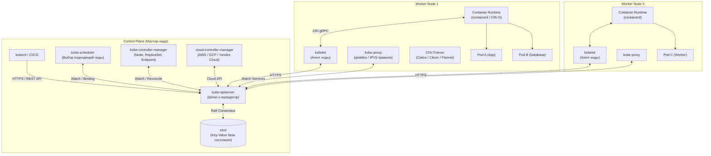

# 01. Архитектура Kubernetes: Control Plane, Worker Nodes и анатомия Pod

> **Главный закон Kubernetes:**  
> Kubernetes — это декларативная распределённая система управления контейнерами, основанная на концепции **Reconciliation Loop** (цикла согласования): система непрерывно сравнивает **Desired State** (желаемое состояние, описанное в YAML) с **Actual State** (фактическим состоянием в кластере) и устраняет расхождения.

---

## 1. Общая архитектура кластера (High-Level Overview)

Кластер Kubernetes делится на два фундаментальных слоя: **Control Plane** (мозг кластера) и **Worker Nodes** (рабочие лошадки, исполняющие нагрузки).



---

## 2. Компоненты Control Plane (Мозг кластера)

Все компоненты Control Plane (кроме etcd) являются **Stateless** (не хранят состояние внутри себя), что позволяет запускать их в режиме High Availability (HA) за балансировщиком нагрузки.

| Компонент | Роль и зона ответственности | Особенности работы под капотом |
| :--- | :--- | :--- |
| **`kube-apiserver`** | Центральный шлюз кластера. Единственный компонент, имеющий прямой доступ к базе `etcd`. | Принимает запросы по REST API (JSON/Protobuf), проводит **Authentication** (сертификаты/токены), **Authorization** (RBAC), прогоняет через цепочку **Admission Controllers** (Mutating/Validating Webhooks). |
| **`etcd`** | Высоконадежная распределенная Key-Value база данных. Хранит абсолютно ВСЁ состояние кластера. | Использует алгоритм консенсуса **Raft**. Требует нечётного количества узлов ($2N+1$: 3 или 5 нод) для сохранения кворума. Любая запись подтверждается большинством. |
| **`kube-scheduler`** | Назначает только что созданные поды (у которых не указан узел `nodeName`) на оптимальные ноды. | Работает в два этапа: <br>1. **Filtering (Predicates):** отсекает ноды, где не хватает CPU/RAM, есть несовместимые Taints или нарушен `nodeSelector`. <br>2. **Scoring (Priorities):** ранжирует оставшиеся ноды по очкам (равномерность нагрузки, сродство affinity) и выбирает победителя. |
| **`kube-controller-manager`** | Демон, объединяющий в себе ключевые контроллеры ядра Kubernetes. | Крутит бесконечные циклы согласования (**Reconciliation Loops**): <br>• *Node Controller* — следит за здоровьем нод (переводит в `NotReady`). <br>• *ReplicaSet Controller* — поддерживает заданное число реплик подов. <br>• *Endpoints Controller* — связывает Services с реальными IP-адресами подов. |
| **`cloud-controller-manager`** | Связующее звено с API облачных провайдеров (Cloud Provider API). | Создает внешние балансировщики (Cloud LoadBalancers), маршруты в VPC, подключает блочные диски (EBS, Managed Disks). |

---

## 3. Компоненты Worker Node (Исполнители)

| Компонент | Роль и зона ответственности | Механизм работы |
| :--- | :--- | :--- |
| **`kubelet`** | Главный агент Kubernetes на каждом сервере. | Общается с `kube-apiserver`. Принимает спецификации `PodSpec` и транслирует их в команды для Container Runtime через gRPC-протокол **CRI** (Container Runtime Interface). Следит за состоянием контейнеров, выполняет healthcheck-пробы (`liveness`, `readiness`, `startup`), репортит статус ноды и ресурсов в Control Plane. |
| **`kube-proxy`** | Сетевой прокси на каждой ноде кластера. | Следит за объектами `Service` и `Endpoints`. Настраивает правила трансляции сетевых адресов на уровне ядра Linux (**iptables** или **IPVS**), перенаправляя трафик с виртуального ClusterIP сервиса на реальные IP-адреса подов. |
| **Container Runtime** | Движок исполнения контейнеров (**containerd**, **CRI-O**). | Загружает образы из Registry, создает cgroups, монтирует rootfs, изолирует namespaces и запускает низкоуровневый рантайм `runc` (OCI). |
| **CNI-плагин** | Сетевой драйвер (**Calico**, **Cilium**, **Flannel**). | Выделяет уникальный IP-адрес каждому поду из пула CIDR кластера, настраивает виртуальные интерфейсы `veth` и маршрутизацию между нодами без необходимости NAT внутри кластера. |

---

## 4. Главный вопрос Senior-собеседований: «Что происходит при `kubectl apply -f pod.yaml`?»

Пошаговая хронология событий от нажатия Enter до запуска приложения:

```
[Инженер: kubectl apply -f pod.yaml]
       │
       ▼ (1. HTTPS POST /api/v1/namespaces/default/pods)
[kube-apiserver]
  ├── Authentication: Кто ты? (Проверка TLS-сертификата или ServiceAccount токена)
  ├── Authorization: Имеешь ли право создавать поды? (Проверка RBAC Role/ClusterRole)
  ├── Mutating Webhooks: Дополнение манифеста (дефолтные лимиты, инъекция sidecar-ов)
  ├── Schema Validation: Проверка структуры YAML-манифеста
  └── Validating Webhooks: Финальная проверка политик безопасности (OPA / Kyverno)
       │
       ▼ (2. Сохранение объекта в базу)
    [etcd]  <-- Статус пода: 'Pending', поле nodeName: "" (нода НЕ назначена)
       │
       ▲ (3. Watch-событие: "Появился новый под без ноды!")
[kube-scheduler]
  ├── Filtering: Исключение неподходящих нод (память, CPU, Taints)
  └── Scoring: Выбор лучшей ноды (например, 'worker-1')
       │
       ▼ (4. Запрос Binding: привязка пода к ноде)
[kube-apiserver] ──> [etcd] (Запись поля: nodeName = "worker-1")
       │
       ▲ (5. Watch-событие: kubelet видит, что ему поручен под)
[kubelet на worker-1]
  ├── (6. Запрос к CRI containerd по gRPC)
  │    ├── Pull Image: скачивание Docker-образа
  │    ├── Start Pause Container: создание сетевого пространства имён (NET namespace)
  │    └── (7. Вызов CNI-плагина: выделение IP-адреса и настройка veth-пары)
  │    └── Start App Containers: запуск основных контейнеров пода через runc
  ├── (8. Мониторинг запуска и пробы Startup / Readiness)
  └── (9. Отправка статуса в Control Plane)
       │
       ▼
[kube-apiserver] ──> [etcd] (Статус пода: 'Running', PodIP: "10.244.1.15")
       │
       ▲ (10. Watch-событие: изменение Endpoints)
[kube-proxy на всех нодах] ──> Обновление iptables/IPVS правил для маршрутизации трафика
```

---

## 5. Статические поды (Static Pods): Как Control Plane запускает сам себя?

> **Парадокс курицы и яйца:**  
> Если `kube-apiserver`, `etcd`, `kube-scheduler` и `kube-controller-manager` сами работают как контейнеры/поды, то кто их запускает, если кластер ещё не работает?

**Ответ: Статические поды (Static Pods).**
* `kubelet` умеет запускать поды **напрямую из локальной директории на диске**, без участия API-сервера!
* По умолчанию эта директория: `/etc/kubernetes/manifests/`.
* `kubelet` сканирует эту папку при старте:
  * `/etc/kubernetes/manifests/kube-apiserver.yaml`
  * `/etc/kubernetes/manifests/etcd.yaml`
  * `/etc/kubernetes/manifests/kube-scheduler.yaml`
  * `/etc/kubernetes/manifests/kube-controller-manager.yaml`
* Если отредактировать файл в этой папке или переместить его, `kubelet` моментально перезапустит или остановит соответствующий компонент Control Plane.

---

## 6. Шпаргалка команд траблшутинга Control Plane и Worker Nodes

```bash
# 1. Проверить статус всех нод кластера:
kubectl get nodes -o wide

# 2. Проверить здоровье компонентов Control Plane (современный метод):
kubectl get --raw='/readyz?verbose'

# 3. Посмотреть поды системных компонентов Control Plane:
kubectl get pods -n kube-system -o wide

# 4. Логи агента kubelet на ноде (systemd служба):
journalctl -u kubelet -n 50 -f --no-pager

# 5. Детальное описание состояния ноды (Taints, емкость ресурсов, условия давления):
kubectl describe node <node-name>
# Ищи секцию Conditions:
# MemoryPressure = False
# DiskPressure = False
# PIDPressure = False
# Ready = True

# 6. Временный вывод ноды из обслуживания (запрет новых подов + перенос существующих):
kubectl cordon <node-name>   # Запретить планирование новых подов
kubectl drain <node-name> --ignore-daemonsets --delete-emptydir-data  # Выселить поды
kubectl uncordon <node-name> # Вернуть ноду в строй
```
