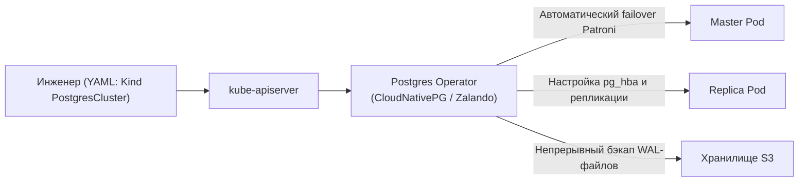

# 02. Stateful vs Stateless: Почему базы данных сложнее веба в Kubernetes

> **Фундаментальная истина оркестрации:**  
> **Stateless (веб-приложения, API, микросервисы)** — это *«расходный материал» (Cattle)*: если под упал, планировщик мгновенно создаст новый с новым IP и случайным именем.  
> **Stateful (СУБД, очереди сообщений, кэши)** — это *«домашние питомцы» (Pets)*: каждому поду жизненно необходимы стабильное имя, собственный диск с данными и предсказуемая роль (Master / Replica).

---

## 1. Сравнительная матрица: Deployment vs StatefulSet

| Критерий | `Deployment` (Stateless) | `StatefulSet` (Stateful) |
| :--- | :--- | :--- |
| **Назначение** | Web API, frontend, воркеры фоновых очередей, proxy. | PostgreSQL, MySQL, Redis Cluster, Kafka, MongoDB, Cassandra, etcd. |
| **Имена подов** | Случайные хеши: `web-7776f57599-7fhq6` | Строгий порядковый индекс: `db-0`, `db-1`, `db-2` |
| **Сетевая идентичность** | Случайные эфемерные IP-адреса, балансировка через Service. | Постоянное доменное имя в DNS через **Headless Service**: `db-0.db-svc.default.svc.cluster.local` |
| **Порядок запуска** | Одновременно (параллельно) без гарантии порядка. | Строго по очереди: `0 -> 1 -> 2` (следующий ждёт `Ready` предыдущего). |
| **Порядок удаления** | Одновременно (параллельно). | Строго в обратном порядке: `2 -> 1 -> 0`. |
| **Хранилище данных** | Общее ephemeral или бездисковое. Если указан PVC, все реплики монтируют один диск. | **`volumeClaimTemplates`**: каждый под `db-N` получает свой собственный уникальный PVC (`data-db-0`, `data-db-1`). |
| **Поведение при удалении пода** | Диск удаляется или перепривязывается случайно. | **Диски (PVC/PV) НЕ удаляются автоматически** для предотвращения потери данных! При пересоздании пода `db-0` диск `data-db-0` возвращается к нему. |

---

## 2. Анатомия StatefulSet: Две обязательные шестерёнки

Чтобы StatefulSet работал корректно, ему необходимы два компонента, которых нет у обычного Deployment:

```mermaid
flowchart TD
    subgraph StatefulSetArchitecture ["Архитектура StatefulSet (Кластер PostgreSQL)"]
        HS["Headless Service\n(clusterIP: None)"] -->|DNS: db-0.db-svc| Pod0["Pod: db-0 (Master)\nIP: 10.244.1.10"]
        HS -->|DNS: db-1.db-svc| Pod1["Pod: db-1 (Replica)\nIP: 10.244.2.15"]
        
        VCT["volumeClaimTemplates"] -.->|Автогенерация| PVC0["PVC: data-db-0"]
        VCT -.->|Автогенерация| PVC1["PVC: data-db-1"]
        
        PVC0 ===|Монтирование /var/lib/postgresql| Pod0
        PVC1 ===|Монтирование /var/lib/postgresql| Pod1
        
        Pod0 ==="Стриминговая репликация WAL (db-0 -> db-1)"===> Pod1
    end
```

### Шестерёнка 1: Headless Service (`clusterIP: None`)
* Обычный Service имеет единый виртуальный ClusterIP и балансирует трафик между подами случайно.
* Базам данных это не подходит: клиенты на запись должны обращаться строго к **Master (`db-0`)**, а реплика `db-1` должна настраивать синхронизацию именно с `db-0`.
* **Headless Service** (`clusterIP: None`) не создаёт единый IP, а создаёт прямые DNS A-записи для каждого пода:
  ```text
  db-0.db-service.namespace.svc.cluster.local -> IP пода db-0
  db-1.db-service.namespace.svc.cluster.local -> IP пода db-1
  ```

### Шестерёнка 2: `volumeClaimTemplates`
* В Deployment нельзя просто написать `persistentVolumeClaim`, иначе все 3 пода попытаются смонтировать один и тот же диск и получат ошибку `Multi-Attach error for volume` (для режима `ReadWriteOnce`).
* `volumeClaimTemplates` в StatefulSet автоматически штампует отдельный диск на каждый порядковый номер пода:
  * `db-0` -> `data-db-0`
  * `db-1` -> `data-db-1`
  * `db-2` -> `data-db-2`

---

## 3. Топ-4 причины, почему базы данных сложнее веба в Kubernetes

### 1. Проблема Split-Brain (Разделение мозга)
Если сетевой канал между нодами мигнёт на 10 секунд:
* Реплика `db-1` решит, что мастер `db-0` умер, и объявит себя новым мастером.
* Приложение продолжит писать в старый `db-0` и новый `db-1`.
* **Результат:** рассинхронизация данных, исправить которую можно только вручную с потерей транзакций.

### 2. Задержка I/O и блокировки файлов (`postmaster.pid`)
СУБД создают лок-файлы на диске. Если нода зависла, Kubernetes пытается запустить под на другой ноде. Но старая нода ещё не отпустила сетевой диск (EBS/Ceph). Новый под падает с ошибкой:  
`FATAL: lock file "postmaster.pid" already exists` или `Volume is already attached to another node`.

### 3. Graceful Shutdown и буферы памяти
Веб-сервер при `SIGTERM` может завершиться за 2-3 секунды. СУБД при выключении обязана:
1. Сбросить «грязные» страницы (dirty buffers) из оперативной памяти (Shared Buffers) на диск.
2. Записать контрольную точку (checkpoint) в WAL-журнал.
3. Корректно закрыть соединения.  
Если `terminationGracePeriodSeconds` выставлен по дефолту (30с), а база большая — Kubernetes прибьёт её по `SIGKILL (9)`, что приведёт к долгому Crash Recovery при следующем старте.

### 4. Обновления и миграция версий
Нельзя сделать Rolling Update СУБД с версии 15 на 16. Файлы данных на диске бинарно несовместимы! Требуется процедура `pg_upgrade` или логический дамп.

---

## 4. Паттерн Kubernetes Operator: Решение проблемы Stateful

Поскольку голый `StatefulSet` решает только инфраструктурные задачи (имена и диски), но не умеет управлять самой базой данных, в продакшене используют **Операторы (Operators)**.

**Оператор = Custom Resource Definition (CRD) + Custom Controller**



Популярные операторы в индустрии:
* **PostgreSQL:** CloudNativePG (CNPG), Zalando Postgres Operator.
* **MySQL:** Percona XtraDB Cluster Operator.
* **Redis:** Redis Operator (OT-CONTAINER-KIT).
* **Kafka:** Strimzi Kafka Operator.

---

## 5. Шпаргалка команд для работы со StatefulSet

```bash
# 1. Посмотреть существующие StatefulSet:
kubectl get statefulset -o wide

# 2. Обрати внимание на имена подов (всегда с суффиксом -0, -1, -2):
kubectl get pods -l app=postgres

# 3. Посмотреть диски, созданные через volumeClaimTemplates:
kubectl get pvc -l app=postgres

# 4. Проверить DNS-запись пода через Headless Service изнутри кластера:
kubectl exec -it <любой-под> -- nslookup db-0.db-svc.default.svc.cluster.local

# 5. Масштабирование StatefulSet (увеличение или уменьшение реплик):
kubectl scale statefulset db --replicas=3

# 6. ВАЖНО: Если удалить StatefulSet, его диски (PVC) останутся в кластере:
kubectl delete statefulset db
kubectl get pvc # Диски на месте! Защита от случайного удаления данных.
```
